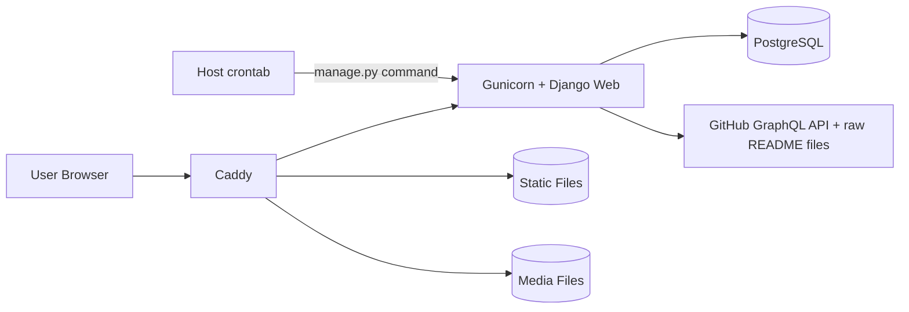
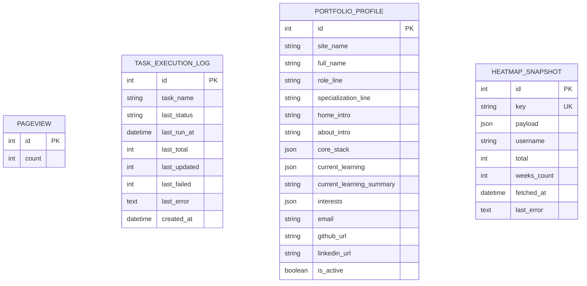
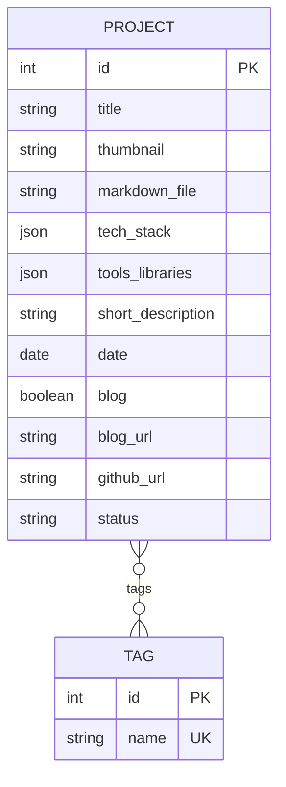
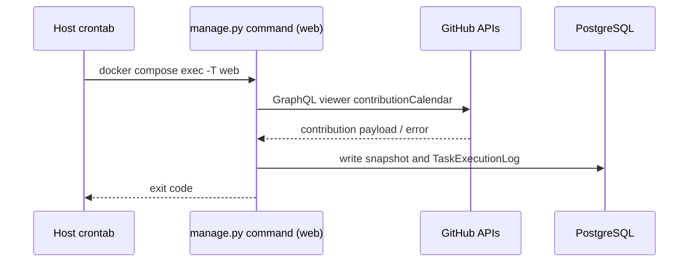

# Architecture

## System Overview

The application is a Django-based portfolio/blog platform with cron-run periodic jobs.
In production (`infra/docker-compose.prod.yml`), the runtime services are orchestrated with Docker Compose:

- `web`: Django app served by Gunicorn.
- `db`: PostgreSQL database.
- `caddy`: reverse proxy and static/media serving.

The host crontab runs periodic jobs as management commands inside `web`.

Dev compose (`infra/docker-compose.dev.yml`) has no Caddy; `web` runs `runserver`, published on `127.0.0.1:8000`.

The heatmap feature is implemented inside Django and fetches GitHub data directly.

## High-Level Diagram

## Backend Architecture

### Django Layering

- `django/config/`: project configuration (`settings.py`, `urls.py`).
- `django/main/models.py`: domain entities, including projects and task execution logging (`TaskExecutionLog`).
- `django/main/views.py`: request handling and template rendering.
- `django/main/tasks.py`: periodic job functions; `django/main/management/commands/` wraps them for cron.
- `django/main/markdown_sync.py` and `django/main/heatmap.py`: integration and domain helpers.

# ERD (Django Models)

### Request Flow

1. A request reaches Caddy.
2. Caddy forwards dynamic routes to Gunicorn/Django.
3. Django middleware runs (`SecurityMiddleware`, sessions, visitor counter, CSRF, auth, etc.).
4. Views read or write data through Django ORM.
5. Templates render HTML using shared context processors.
6. The response is returned through Caddy.

## Periodic Jobs

The host crontab runs `docker compose exec -T web python manage.py <command>` (entries in "New droplet bootstrap" in `docs/implementation.md`).

- `refresh_heatmap`: every hour. `sync_markdowns`: every 2 hours.
- Admin "Sync" buttons on `/about` run the same job functions inside the request.
- Task observability: each run appends a `TaskExecutionLog` row; the newest row per task is its current status.

## Direct GitHub Heatmap Integration

The project fetches GitHub contribution heatmap data directly from Django.

- The GitHub bearer token is configured with `GITHUB_HEATMAP_TOKEN`.
- Django sends one GitHub GraphQL `viewer` query for the token owner's login and contribution days.
- Data is normalized and persisted in `HeatmapSnapshot`.
- On token or upstream errors, Django returns safe fallback messages and keeps the last valid snapshot.
- The `/about/heatmap-data/` endpoint only serves the stored snapshot; GitHub is called by the cron job or the admin "Sync Heatmap" button.

### Job Flow Diagram

## Static and Media Delivery

- Django collects static files into `/app/staticfiles`.
- User uploads are stored in `/app/media`.
- Docker named volumes share these directories with Caddy.
- Caddy serves static/media directly for efficiency.

## Security and Configuration

- Environment variables are loaded from `.env` via `django-environ`.
- `SECRET_KEY` is required; startup fails if missing.
- In non-debug mode, secure cookie and HTTPS settings are enabled; the deploy fails if `check --deploy --fail-level WARNING` reports anything.
- In production Caddy adds `basic_auth` in front of `/admin*`.
- Allowed hosts and CSRF trusted origins are controlled by env vars.

## Extensibility Notes

- Keep views thin; move business logic into helpers/services/tasks.
- Keep task payloads and return structures stable.
- Add new periodic jobs as a management command with explicit task logging, a crontab entry and a `SCHEDULED_JOBS` row in `django/main/views.py`.
