# Frontend Diagram

This diagram shows the current template composition around the shared layout, footer, and reusable components.

Related docs:

- [`README.md`](../README.md)
- [`architecture.md`](architecture.md)
- [`implementation.md`](implementation.md)

## Template structure

- `base.html` is the root layout for all pages. It contains the navbar, global scripts, and the global footer.
- Every page extends `base.html` and fills the main blocks (`content`, optional `sidebar`, optional `extra_scripts`). Head blocks (`title`, `meta_description`, `og_title`, `og_description`, `og_image`) set the SEO and Open Graph/Twitter tags.
- In practice there are 3 main page types inside this structure:
  1. static/content pages (`pages/home.html`, `pages/about.html`, error pages),
  2. projects listing (`projects/index.html`),
  3. project detail/blog page (`projects/detail.html`).
- `projects/detail.html` is rendered per project entry from the database (`Project`), resolved by slug (`/blog/<slug>/`).
- Error pages are `404.html` and `500.html` at the templates root.
- Hero backgrounds are WebP (`hero-bg.webp`, `hero-bg2.webp`); `hero-bg.png` is kept only as the default `og:image`.

```mermaid
flowchart TD
    Base["base.html\n(navbar + footer + global blocks)"]
    ThemeJS["static/js/theme-toggle.js"]
    MobileJS["static/js/mobile-menu.js"]
    ProjectsJS["static/js/projects-filters.js"]
    MathJax["static/js/mathjax-config.js + MathJax 3.2.2 CDN (detail page)"]

    Home["pages/home.html"]
    About["pages/about.html"]
    Errors["404.html + 500.html"]
    ProjectsIndex["projects/index.html"]
    ProjectDetail["projects/detail.html"]
    ProjectDB["Project model (DB)"]

    Hero["components/hero_section.html"]
    HeroContent["components/hero/*_content.html"]
    TimelineSection["components/timeline_section.html"]
    TimelineItem["components/timeline_project_item.html"]
    ProjectCard["projects/components/project_card.html"]
    ProjectFooter["projects/components/project_footer.html"]
    Sidebar["projects/components/blog_projects_sidebar.html\n+ blog_sidebar_cards.html"]
    GithubIcon["components/icons/github_icon.html"]
    LinkedinIcon["components/icons/linkedin_icon.html"]

    Home --> Base
    About --> Base
    Errors --> Base
    ProjectsIndex --> Base
    ProjectDetail --> Base

    Base --> ThemeJS
    Base --> MobileJS
    Base --> GithubIcon
    Base --> LinkedinIcon

    Hero --> HeroContent

    Home --> Hero
    Home --> TimelineSection
    TimelineSection --> TimelineItem

    About --> Hero
    Errors --> Hero

    ProjectsIndex --> Hero
    ProjectsIndex --> ProjectCard
    ProjectsIndex --> ProjectsJS

    ProjectDB --> ProjectsIndex
    ProjectDB --> ProjectDetail
    ProjectDetail --> Sidebar
    ProjectDetail --> ProjectFooter
    ProjectDetail --> MathJax
```

